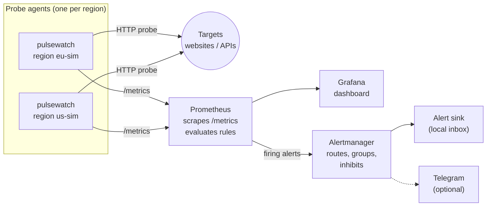
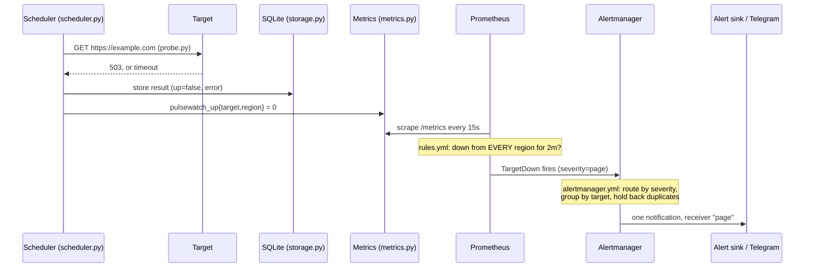

# Pulsewatch: the project guide

This guide explains the whole project in plain language. Read it from top to bottom once, and you will know what every part does, why it is there, and why it is built that way. The [README](../README.md) is the reference. This file is the story.

**Contents**

1. [What Pulsewatch is](#1-what-pulsewatch-is)
2. [The big picture](#2-the-big-picture)
3. [The life of one probe, from HTTP request to Telegram](#3-the-life-of-one-probe)
4. [The ideas that make it more than a pinger](#4-the-ideas-that-make-it-more-than-a-pinger)
5. [Where everything lives](#5-where-everything-lives)
6. [Four ways to run it, and when to use each](#6-four-ways-to-run-it)
7. [What CI proves on every change](#7-what-ci-proves-on-every-change)
8. [Honest limits](#8-honest-limits)
9. [Lessons learned and common questions](#9-lessons-learned-and-common-questions)
10. [Glossary](#10-glossary)

---

## 1. What Pulsewatch is

Pulsewatch watches websites and APIs and tells you when they break.

On a fixed interval (every 30 seconds by default) it sends an HTTP request to each **target** (for example `https://example.com`). It records whether the target answered with the expected status code and how long the answer took. From those results it produces:

- a REST API with uptime and latency numbers,
- Prometheus **metrics**,
- a Grafana **dashboard**,
- **alerts** that go to an inbox and, if you switch it on, to your phone through Telegram.

The Python code is small (about 650 lines, including the alert inbox). The value of the project is everything around it: the same service runs in Docker Compose, in Kubernetes, in several simulated **regions** at once, created by Terraform and kept in sync by Argo CD. CI tests all of it on every pull request, on a real cluster. This is the work a DevOps or SRE team does every day, at a size one person can understand fully.

Everything runs on your own machine. There is no cloud account, no registry and no cost.

---

## 2. The big picture



Five components, each doing one job:

| Component | Job | Where the code or config is |
|---|---|---|
| **Pulsewatch agent** | Probes targets, stores results in SQLite, serves the API and `/metrics` | `src/pulsewatch/` |
| **Prometheus** | Collects metrics from every agent, computes uptime, latency and SLO numbers, decides which alerts fire | `deploy/prometheus/` |
| **Alertmanager** | Decides who gets told about each alert, and how often | `deploy/alertmanager/` |
| **Alert sink** | A tiny inbox that receives every notification, so alerting can be tested without any account | `src/pulsewatch/alertsink.py` |
| **Grafana** | Shows all of it as a dashboard | `deploy/grafana/` |

---

## 3. The life of one probe

Follow one request through the whole system. Every step names the file that does it.



1. **Schedule.** `scheduler.py` starts one loop per target. Each loop waits a short random time first, so targets do not all fire at the same moment. Then it probes every `interval_seconds`.
2. **Probe.** `probe.py` sends the request with a timeout. It never raises an exception. A timeout or connection error becomes a result with `up=false` and an `error` string, so one broken target cannot stop the loop.
3. **Store.** `storage.py` writes the result to SQLite. The `/status` API endpoint reads from here and calculates uptime % and p50/p95 latency. Old rows are deleted every hour (default retention: 72 hours).
4. **Expose.** `metrics.py` updates three series after each probe: `pulsewatch_up` (1 or 0), a latency histogram, and a counter of probes by result. A fourth, `pulsewatch_slo_objective`, is set once at startup from `targets.yaml`. Every series has `target` and `region` labels.
5. **Collect.** Prometheus scrapes `/metrics` every 15 seconds. In Kubernetes it finds the agents by itself through the Kubernetes API (service discovery), so a new region needs no config change.
6. **Decide.** Prometheus evaluates `deploy/prometheus/rules.yml` every 15 seconds. If the rule condition stays true for long enough (the `for:` time), the alert fires.
7. **Route.** Alertmanager receives the alert and follows `deploy/alertmanager/alertmanager.yml`: `severity=page` goes to the `page` receiver and `severity=warn` to `warn`. It groups by target, so one broken target gives one message, and it holds back alerts that only repeat what a bigger alert already said (inhibition).
8. **Deliver.** Every receiver delivers to the alert sink. If you created a Telegram bot token on your machine, `page` and `warn` also go to Telegram.

---

## 4. The ideas that make it more than a pinger

Anyone can write a script that pings a URL. These five ideas are what a reviewer will ask about.

### 4.1 Consensus alerting across regions

One probe location can be wrong: its network can break while the target is fine. So `TargetDown` only pages when the target is down **from every region**:

```promql
max by (target) (pulsewatch_up) == 0
```

`max` over the regions is 0 only when all of them see the target down. If only some regions fail, `TargetDownInSomeRegions` sends a **warning**, not a page. That points to a network-path problem or a bad probe location.

### 4.2 Meta-monitoring: who watches the watchers?

Consensus has a blind spot. A dead agent does not report "down", it reports **nothing**. It silently drops out of the vote, and if every agent dies, `TargetDown` can never fire. Two alerts close the gap:

- `ProbeRegionMissing` (warn): a region that reported in the last hour has stopped.
- `ProbeAgentsAbsent` (page): no agent reports at all, so alerting is blind.

A third, `AlertmanagerNotificationsFailing`, catches a broken delivery path, for example a revoked Telegram token. One gap is left: if Alertmanager itself is down, nothing can deliver any alert. Closing that needs a "dead man's switch", a heartbeat sent to a service outside the stack, which a local-only project does not have.

### 4.3 SLOs and error budgets

An **SLO** (service level objective) is a promise such as "this target is up 99.5% of the time over 7 days". The remaining 0.5% is the **error budget**: about 50 minutes of allowed downtime a week.

The **burn rate** says how fast you spend that budget. Burn rate 1 spends it in exactly 7 days. Burn rate 14.4 spends it in about 12 hours.

Why this matters: `TargetDown` needs 2 minutes of *continuous* downtime. A target that fails every third probe never trips it, but users still see errors. `ErrorBudgetBurnFast` catches that. Each burn alert checks a long window (enough budget really spent) and a short window (still failing now), so it fires on real problems and stops soon after recovery. This method comes from the Google SRE Workbook, chapter 5.

### 4.4 Inhibition: one page per outage

During a full outage, many alerts are true at the same time: down, slow, burning budget. Two mechanisms keep this to one page. Alertmanager's `inhibit_rules` hold back the smaller alerts (`TargetDownInSomeRegions`, `TargetSlow`, `ErrorBudgetBurnSlow`) while `TargetDown` fires for the same target. `ErrorBudgetBurnFast` is kept quiet by its own rule instead: it does not fire for a target where `TargetDown` fired in the last 10 minutes.

### 4.5 One set of manifests, three ways to apply them

The Kubernetes manifests are written once, as Kustomize **overlays** (`deploy/k8s/overlays/`). Three tools apply exactly the same files:

- `kubectl apply -k` (through `make kind-up`), the manual way,
- Terraform (`infra/terraform/`), which also creates the cluster,
- Argo CD (`deploy/argocd/`), which reads them from GitHub and keeps the cluster in sync with Git.

Nothing is copied between them, so they cannot drift apart. Tests enforce that.

---

## 5. Where everything lives

```
src/pulsewatch/        the Python service
  config.py              targets.yaml format and PULSEWATCH_* settings
  probe.py               one HTTP probe -> ProbeResult
  scheduler.py           one loop per target, hourly pruning
  storage.py             SQLite: results, uptime %, percentiles
  metrics.py             Prometheus series
  api.py                 FastAPI app: /healthz /targets /status /results /check /metrics
  alertsink.py           the local alert inbox (standard library only)
  main.py                `pulsewatch` command

deploy/                everything that runs the service
  prometheus/            rules.yml (all alerts), rules.test.yml (their tests), scrape configs
  alertmanager/          routing, Telegram variant, start.sh (chooses which one at start)
  grafana/               datasource + dashboard JSON
  k8s/base/              the agent: Deployment, Service, PVC, targets
  k8s/monitoring/        Prometheus, Alertmanager, alert sink, Grafana, RBAC
  k8s/overlays/kind/           one region, everything in one namespace
  k8s/overlays/multi-region/   eu + us agents in their own namespaces, monitoring shared
  argocd/                Argo CD install (pinned) + the ApplicationSet that deploys the overlays

infra/terraform/       creates the kind cluster, loads the image, applies an overlay
scripts/chaos_check.py checks used by the chaos experiments
tests/                 113 tests: code, configs, manifests, alerting, Terraform, Argo CD
.github/workflows/     CI (11 jobs, section 7)
Makefile               every command you type: kind-up, argocd-up, chaos-*, alerts-*
docker-compose.yml     the quickest way to run everything
DECISIONS.md           the decisions you made, with options and reasons
```

When you change something, this table tells you where:

| You want to... | Edit |
|---|---|
| Watch a new website | `targets.yaml` (compose) or `deploy/k8s/base/targets.yaml` (Kubernetes) |
| Change when an alert fires | `deploy/prometheus/rules.yml`, then add a case to `rules.test.yml` |
| Change who gets notified | `deploy/alertmanager/alertmanager.yml` **and** `alertmanager-telegram.yml` (a test fails if they differ) |
| Add a region | copy `deploy/k8s/overlays/multi-region/region-us/`, rename it, list it in the parent `kustomization.yaml` |
| Add an API endpoint | `src/pulsewatch/api.py` and `tests/test_api.py` |

---

## 6. Four ways to run it

**Before you start**, install what the way you pick needs. Versions that CI uses are the safe choice:

| Tool | Version | Needed for |
|---|---|---|
| Docker (with Compose) | any recent | everything |
| [kind](https://kind.sigs.k8s.io/docs/user/quick-start/#installation) | **v0.31.x** (matches the pinned node image `kindest/node:v1.35.0`) | Kubernetes, Terraform, Argo CD |
| [kubectl](https://kubernetes.io/docs/tasks/tools/) | 1.30 or newer | Kubernetes, Argo CD |
| [Terraform](https://developer.hashicorp.com/terraform/install) | 1.6 or newer (CI uses 1.9.8) | Terraform |
| Python | 3.11 or newer | running tests or the service without Docker |

Optional, for `make k8s-validate`: `kubeconform`, `promtool` (comes with Prometheus) and `amtool` (comes with Alertmanager).

| Way | Command | Use it when | Needs |
|---|---|---|---|
| **Docker Compose** | `docker compose up --build` | You want to see it working in two minutes | Docker |
| **kind + kubectl** | `make kind-up` (add `OVERLAY=deploy/k8s/overlays/multi-region` for two regions), then `make k8s-forward` | You want to see it on Kubernetes and poke at pods | Docker, kind, kubectl |
| **Terraform** | `cd infra/terraform && terraform init && terraform apply` | You want the whole platform from one command, and gone with `terraform destroy` | + Terraform |
| **Argo CD** | `make argocd-up`, then `make argocd-ui` | You want GitOps: merge a change on GitHub and watch the cluster follow | Docker, kind, kubectl |

After any of them, these addresses work (Kubernetes needs `make k8s-forward` running):

| What | Address |
|---|---|
| API docs | http://localhost:8000/docs |
| Prometheus | http://localhost:9090 |
| Grafana | http://localhost:3000 |
| Alertmanager | http://localhost:9093 |
| Alert inbox | http://localhost:9095/notifications |

**A first session that shows everything** (about 15 minutes):

```bash
make kind-up OVERLAY=deploy/k8s/overlays/multi-region
make k8s-forward API_NS=pulsewatch-eu          # leave this running, use a second terminal
make chaos-partition                           # cut region "us" off from example.com
# wait 5 minutes, then:
make chaos-alerts                              # expect TargetDownInSomeRegions, no TargetDown
make alerts-inbox                              # the warning arrived in the "warn" inbox
make chaos-heal
make kind-down
```

Take a screenshot of Grafana while the partition is active. It is the best picture of the project to put in the README.

**When something goes wrong:**

| Symptom | Likely cause | What to do |
|---|---|---|
| `docker compose up` fails with "port is already allocated" | Something else uses 8000, 9090, 9093, 9095 or 3000 | Stop the other program, or change the left port number in `docker-compose.yml` |
| Pods stay in `ErrImagePull` / `ImagePullBackOff` | The `pulsewatch:dev` image is not inside the kind cluster | Run `make kind-up` again (it builds and loads the image), or `kind load docker-image pulsewatch:dev --name pulsewatch` |
| `kind load` fails with a containerd error | Your `kind` CLI does not match the node image | Use kind v0.31.x (table above) |
| `make k8s-forward` says "unable to forward" | The pod is not ready yet, or the service is in another namespace | `make k8s-status`. For two regions, add `API_NS=pulsewatch-eu` |
| Grafana panels say "No data" | Prometheus has not scraped yet, or the time range is too short | Wait one minute. Check http://localhost:9090/targets: every target must be `UP` |
| Argo CD apps stay `OutOfSync` or `Missing` | Argo CD polls GitHub every 60 seconds, or the branch does not exist | Wait one minute, then `make argocd-status`. `ARGOCD_REVISION` must be a pushed branch or commit |
| No Telegram message | Token or chat id is wrong, or you did not message the bot first | `make alerts-inbox` shows what Alertmanager sent. Alertmanager logs show the Telegram error (they contain the token, so do not paste them anywhere) |
| A test fails after you edit a config | The tests check that files agree with each other | Read the assertion message. It names the two things that differ |

---

## 7. What CI proves on every change

CI (`.github/workflows/ci.yml`) runs 11 jobs on every push. Most finish in 1 to 3 minutes. `chaos` takes about 20.

| Job | What it proves |
|---|---|
| `lint` | Code style (ruff) |
| `test` | 113 unit and config tests on Python 3.11, 3.12 and 3.13 |
| `docker` | The image builds and the container answers `/healthz` |
| `stack` | The full compose stack runs. Alert rules pass their unit tests (`promtool test rules`). Routing goes to the right receiver (`amtool`). A target that is always down produces `TargetDown`, and it arrives in the `page` inbox |
| `k8s-manifests` | Every overlay renders and is valid Kubernetes (kubeconform, strict) |
| `kind` | One region on a real kind cluster: API, scrape, dashboard, results survive a pod restart, Telegram on/off with a fake token |
| `kind-multi-region` | Two regions: Prometheus discovers both and sees two distinct `region` labels |
| `chaos` | All three chaos experiments: the right alert fires, reaches the right receiver, and the wrong alerts stay quiet |
| `argocd` | Argo CD deploys the commit under test, all apps reach Synced/Healthy, and a deleted Deployment comes back by itself |
| `terraform-lock` | The provider lockfile is complete for every platform |
| `terraform` | `terraform apply` builds the whole platform, a second `plan` shows no changes, `destroy` cleans up |

Failing Kubernetes jobs print pod status, events and logs as **annotations** on the PR, so you can debug from the checks page.

---

## 8. Honest limits

These are deliberate trade-offs for a local, zero-cost project. Each one says what a production setup would do instead.

- **The regions are simulated.** "eu-sim" and "us-sim" run on the same laptop, so they show the design (discovery, labels, consensus) and not real geographic diversity. Real regions are the same manifests on clusters in different places, with Prometheus federation or remote-write on top.
- **SQLite allows one writer.** Each region therefore runs exactly one agent (`replicas: 1`, `strategy: Recreate`). You scale out by adding regions, not replicas. `storage.py` is the place to swap in Postgres.
- **Prometheus data lives on an `emptyDir` in Kubernetes.** A Prometheus pod restart deletes the history, so the 7-day SLO numbers are then calculated from only the time since the restart. On a fresh cluster or after a restart, a short failure counts for a large share of that short history, and `ErrorBudgetBurnSlow` can warn early. A real setup uses a PersistentVolume.
- **Nothing watches Alertmanager from outside.** If Alertmanager is down, no alert can reach you (section 4.2).
- **No authentication anywhere.** It is a local stack. Compose publishes every port on `127.0.0.1` only, and in Kubernetes you reach things through `kubectl port-forward`. Grafana's `admin/admin` is a local default.
- **The image is side-loaded, not pulled.** `kind load` puts the image into the cluster directly, so no registry is needed. Argo CD therefore syncs manifests but not image versions.
- **The version number is still `0.1.0`.** The code has grown a lot since then. Tag a release (for example `v1.0.0`) when you are happy with it.

---

## 9. Lessons learned and common questions

**Three real problems from building this, and what fixed them:**

1. **The pod that crashed for no reason.** On Kubernetes, the agent crashed at startup with "PULSEWATCH_PORT: unable to parse `tcp://10.96.x.x:8000` as an integer". Cause: Kubernetes injects Docker-link style environment variables for every Service, and a Service named `pulsewatch` produces `PULSEWATCH_PORT`, which collides with the app's own `PULSEWATCH_*` settings. Fix: `enableServiceLinks: false` on every pod, and a regression test that fails if anyone removes it.
2. **CI went red overnight with no change in the repo.** The Terraform job failed one morning. Cause: there was no provider lockfile, so `terraform init` picked up a new `tehcyx/kind` provider release that broke `kind load`. Fix: commit `.terraform.lock.hcl`, pin the kind node image, and a CI job that fails if the lockfile is incomplete. Lesson: an unpinned dependency is a change you did not review.
3. **Argo CD stuck in ImagePullBackOff.** Argo CD's Redis image comes from `public.ecr.aws`, which rate-limits, and upstream sets `imagePullPolicy: Always`. Fix: pre-pull the images with retries in CI, and patch the policy to `IfNotPresent`.

**Common questions about the design:**

- *Why not just alert when a probe fails?* One location can be wrong. Consensus across regions removes false pages from a bad vantage point, and the partial case still produces a warning.
- *What if the monitoring itself dies?* `ProbeRegionMissing` and `ProbeAgentsAbsent` cover lost probe agents, and `AlertmanagerNotificationsFailing` covers a broken receiver. Alertmanager being down is not covered (section 4.2).
- *Why SLO burn rates on top of TargetDown?* TargetDown misses intermittent failures. A burn rate measures how fast the error budget goes, with a long and a short window so it is neither noisy nor slow to clear.
- *Why Kustomize and not Helm?* There is one app with small differences per environment. Overlays express that directly, and kubectl and Argo CD support them with no extra tool.
- *How do you keep secrets out of Git?* The Telegram token only exists on the owner's machine. It goes into a git-ignored `.env` or a Kubernetes Secret created from your shell, and Alertmanager reads it from a 0600 file, never from a config file.
- *What would you change for production?* Real clusters per region, a registry with signed images, persistent Prometheus storage or remote-write, authentication in front of the UIs, and Postgres instead of SQLite.

---

## 10. Glossary

| Term | Meaning here |
|---|---|
| **Target** | A URL that Pulsewatch probes |
| **Probe** | One HTTP request to a target, with a timeout |
| **Agent** | One running Pulsewatch process. There is one per region |
| **Region** | A label (`eu-sim`, `us-sim`) that says where a probe came from |
| **Scrape** | Prometheus fetching `/metrics` from an agent |
| **Recording rule** | A Prometheus query saved as a new series, for example `pulsewatch:target_up` |
| **Alert rule** | A query that fires an alert when it stays true for the `for:` time |
| **Severity** | `page` (wake someone up) or `warn` (look at it during the day) |
| **Receiver** | Where Alertmanager sends a notification: `page`, `warn`, `default` |
| **Inhibition** | Alertmanager holding back an alert because a bigger one already covers it |
| **SLO / error budget / burn rate** | The availability promise / the downtime it allows / how fast that allowance is being spent (section 4.3) |
| **Meta-monitoring** | Alerts about the monitoring system itself |
| **kind** | "Kubernetes in Docker": a real cluster that runs as containers on your laptop |
| **Kustomize overlay** | A folder that takes the base manifests and changes a few things (namespace, region, image tag) |
| **GitOps** | The cluster follows what is in Git. Argo CD makes that happen |
| **ApplicationSet** | An Argo CD object that creates one Application per folder it finds |
| **IaC** | Infrastructure as code. Here: Terraform describes the cluster and what runs on it |
| **Chaos experiment** | Breaking something on purpose to prove the alerts work |
